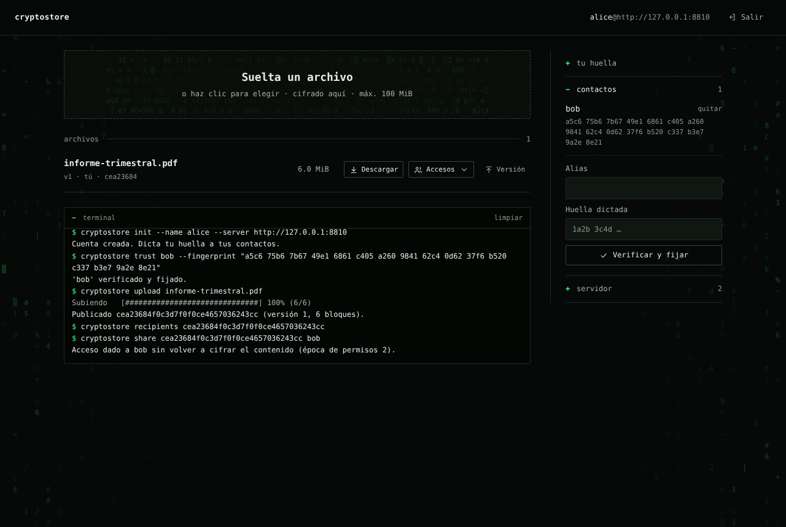

# cryptostore — almacenamiento cifrado y compartición de archivos

Proyecto 5 · Criptografía aplicada · Diana Garcia Escorcia, John Ferrer Avila, Alexy Salcedo Tete.

Cada archivo se cifra **en el cliente** antes de subirlo; el servidor solo guarda objetos opacos.
El dueño comparte un archivo con otros usuarios **sin entregar su clave privada y sin volver a
cifrar el contenido**: sella la clave del archivo para cada destinatario con HPKE (RFC 9180).
Retirar el acceso impide obtener esa clave desde el servidor, pero **no borra una copia que el
destinatario ya haya descargado**, y el producto lo dice así cada vez que se revoca.



---

## Índice

1. [Arquitectura: servidor, web y cliente de terminal](#1-arquitectura-servidor-web-y-cliente-de-terminal)
2. [Diseño criptográfico](#2-diseño-criptográfico)
3. [Qué ve el servidor y qué no](#3-qué-ve-el-servidor-y-qué-no)
4. [Correspondencia con el I+D (primera entrega)](#4-correspondencia-con-el-id-primera-entrega)
5. [Correspondencia con el enunciado](#5-correspondencia-con-el-enunciado)
6. [Instalación](#6-instalación)
7. [Configuración (`.env`) y escenarios de red](#7-configuración-env-y-escenarios-de-red)
8. [Uso: terminal](#8-uso-terminal)
9. [Uso: interfaz web](#9-uso-interfaz-web)
10. [Docker](#10-docker)
11. [Pruebas](#11-pruebas)
12. [Mediciones](#12-mediciones)
13. [Estructura del código](#13-estructura-del-código)
14. [Límites y fuera de alcance](#14-límites-y-fuera-de-alcance)

---

## 1. Arquitectura: servidor, web y cliente de terminal

```
   Equipo de Bob                     Equipo A (192.168.1.20)                 Equipo de Carol
 ┌──────────────────┐            ┌────────────────────────────┐            ┌──────────────────┐
 │ cryptostore      │  HTTP/API  │  cryptostore-server        │  HTTP/API  │ navegador        │
 │ (terminal)       ├───────────►│  bloques · manifiestos ·   │◄───────────┤   │ HTTPS        │
 │ claves + cifrado │            │  envolventes (opacos)      │            │   ▼              │
 └──────────────────┘            │                            │            │ cryptostore web  │
                                 │  (opcional) cryptostore web│◄── HTTPS ──│ (local o de A)   │
                                 └────────────────────────────┘            └──────────────────┘
```

| Pieza | Comando | Qué hace | Dónde se descifra |
|---|---|---|---|
| **server** | `cryptostore-server` | Guarda y sirve bloques cifrados, manifiestos firmados y envolventes. No tiene ninguna clave. | Nunca |
| **client** | `cryptostore …` | Cliente solo terminal: identidad, cifrar, subir, bajar, compartir, revocar. | En el equipo que lo ejecuta |
| **web** | `cryptostore web` | El mismo cliente con interfaz en el navegador y login por usuario. Puede ser solo local o abrirse a la red. | En el equipo que ejecuta `web` |

- El servidor es un **monolito modular** (I+D §6.3): sesión/autenticación, almacenamiento de bloques,
  manifiestos y envolventes son módulos separados dentro de un solo proceso FastAPI.
- `client` y `web` usan **las mismas carpetas de usuario**: lo hecho en una se ve en la otra.
- Cada pieza puede estar en una máquina distinta. Los clientes eligen a qué servidor conectarse
  (`--server` o `CRYPTOSTORE_SERVER_URL`), así que un mismo cliente puede trabajar con servidores distintos
  usando carpetas de usuario distintas.

---

## 2. Diseño criptográfico

Primitivas (todas de bibliotecas auditadas, ninguna implementada a mano):

| Uso | Primitiva | Biblioteca |
|---|---|---|
| Contenido y metadatos | ChaCha20-Poly1305 (RFC 8439) | `cryptography` |
| Envolventes de la clave de datos | HPKE modo base: DHKEM(X25519, HKDF-SHA256), HKDF-SHA256, ChaCha20-Poly1305 (RFC 9180) | `pyhpke` |
| Subclaves | HKDF-SHA256 (RFC 5869) | `cryptography` |
| Firma del manifiesto | Ed25519 | `cryptography` |
| Huellas y hashes de bloque | SHA-256 | `hashlib` |
| Clave del archivo de identidad | scrypt (N=2¹⁵, r=8, p=1) | `cryptography` |

Los tres vectores oficiales (RFC 9180 A.2, RFC 8439 §2.8.2, RFC 5869 caso 1) se comprueban en `tests/test_rfc_vectors.py`.

### 2.1 Identidad y confianza sin PKI (TOFU)

- Cada usuario genera **dos pares de claves**: X25519 (recibir envolventes) y Ed25519 (firmar manifiestos).
- **Huella** = `SHA-256(pk_X25519 ‖ pk_Ed25519)`, en hexadecimal; se muestra en grupos de 4 (`1a2b 3c4d …`). Es también el identificador del usuario.
- Las claves privadas se guardan en `identity.json`, cifradas con ChaCha20-Poly1305 y una clave derivada de la contraseña con scrypt. La cabecera (nombre, parámetros, sal) va como datos asociados: editarla rompe el archivo.
- **Verificar a alguien** = escribir la huella que esa persona dicta por un canal confiable. El cliente pide al servidor la identidad con esa huella y comprueba localmente que las claves recibidas la producen. Si coincide, se fija en la libreta (`trust-store.json`). Si más adelante el servidor entrega otra clave para ese alias, se rechaza.
- Solo se comparte con contactos verificados, y solo se abre un archivo si su dueño está verificado.

### 2.2 Cifrado por bloques

Por cada **versión** de un archivo: `DEK ← CSPRNG(32 B)`, `file_id ← CSPRNG(16 B)`, `prefijo ← CSPRNG(4 B)`.
De la DEK se derivan con HKDF dos subclaves independientes: `k_bloques` y `k_metadatos`.

El archivo se corta en bloques de 1 MiB (configurable de 1 KiB a 4 MiB). Para el bloque `i` de `N`:

```
nonce_i = prefijo(4) ‖ UInt64BE(i)                                              (12 B, nunca se repite)
AAD_i   = "BLK\x01" ‖ file_id(16) ‖ UInt32BE(versión) ‖ UInt32BE(i) ‖ UInt32BE(N) ‖ es_último(1)   (33 B)
bloque_i = ChaCha20-Poly1305(k_bloques, nonce_i, P_i, AAD_i) = C_i ‖ T_i(16)
H_i     = SHA-256(bloque_i)
```

Un archivo vacío es **un bloque de 0 bytes** (solo la etiqueta). Ni el nonce ni el AAD se almacenan: se recalculan.

### 2.3 Metadatos privados

`{name, mime_type, size}` en JSON canónico, cifrado con `k_metadatos`, nonce aleatorio y
AAD = `"META\x01" ‖ file_id ‖ versión`. Viaja dentro del manifiesto.

### 2.4 Manifiesto firmado

Objeto JSON canónico (subconjunto de RFC 8785: claves ordenadas, sin decimales) con
`format, suite, file_id, content_version, owner_id, nonce_prefix, block_size, block_hashes[], encrypted_metadata, created_at`,
firmado por el dueño con Ed25519 (dominio `"MANIFEST\x01"`). Es **inmutable**: compartir o revocar no lo toca;
una versión nueva del contenido produce un manifiesto nuevo con versión mayor.

### 2.5 Envolventes (compartir sin recifrar)

```
info = "p5/grant/v1" ‖ file_id ‖ UInt32BE(versión) ‖ id_destinatario
aad  = SHA-256(manifiesto firmado)
(enc, ct) = HPKE-SealBase(pk_X25519_destinatario, info, aad, DEK)        → 32 B + 48 B = 80 B
```

Cada envolvente es un objeto aparte en el servidor (no está dentro del manifiesto). El dueño también
guarda la suya, para poder volver a abrir y compartir el archivo. Compartir con alguien nuevo = abrir la
envolvente propia, sellar la DEK para el nuevo destinatario y subir 80 bytes; **los bloques no se tocan**.

### 2.6 Descarga verificada (fail-stop)

1. Bajar el manifiesto; verificar que el dueño es un contacto verificado (o uno mismo), la firma Ed25519 y que la versión no sea anterior a la última vista (anti-retroceso).
2. Abrir la envolvente propia (HPKE-Open) → DEK; descifrar los metadatos.
3. Bajar **todos** los bloques; comprobar longitud y `SHA-256` contra el manifiesto.
4. Descifrar cada bloque con su nonce y AAD de posición en un archivo temporal oculto.
5. Comprobar que el tamaño total coincide con los metadatos.
6. Solo entonces, **renombrado atómico** al destino. Ante cualquier fallo se borra todo y el destino no se crea.

Así se detectan: bloque **modificado** (falla la etiqueta), **faltante** o **truncado** (huella/longitud, `N`, `es_último`),
**duplicado** o **reordenado** (huella y AAD de posición), **de otro archivo o versión** (file_id/versión en el AAD y otra DEK),
**manifiesto alterado** o **fabricado por el servidor** (firma), **versión vieja** (anti-retroceso).

### 2.7 Revocación

Revocar = pedir al servidor que borre la envolvente del destinatario y aumentar el contador `acl_epoch`.
Desde ese momento el servidor no le entrega la DEK. **Lo que ya descargó (archivo o DEK) sigue en su equipo**;
ninguna operación criptográfica puede borrarlo. Para que no lea cambios futuros se publica una **versión nueva**
(`upload --replace`): usa una DEK nueva que solo se sella para los destinatarios vigentes.

### 2.8 Versiones, reintentos y reanudación

- Cada versión tiene **su propia DEK y prefijo de nonce**: el par (clave, nonce) nunca se repite entre versiones.
- Reintentar un bloque es inofensivo: mismo texto, clave y posición dan el mismo cifrado; el servidor acepta el mismo bloque y rechaza (409) uno distinto en la misma posición.
- Antes de enviar nada se guarda un **punto de control local** (cifrado con una subclave de la identidad) con la DEK, el prefijo y la huella del **texto plano de cada bloque**. Si la subida se corta, la siguiente reutiliza la clave solo si el archivo es idéntico bloque a bloque, y además compara cada bloque justo antes de enviarlo. Un bloque cambiado nunca sale cifrado con una clave y nonce ya usados.
- Las versiones publicadas son inmutables en el servidor.

---

## 3. Qué ve el servidor y qué no

| El servidor **sí** conoce (necesario para operar) | El servidor **no** conoce |
|---|---|
| Identidades públicas y huellas | Claves privadas, contraseñas |
| `file_id`, versión, dueño, nº y tamaño de bloques, hashes | Contenido de los archivos |
| Quién comparte con quién (envolventes) y cuándo | Nombre y tipo MIME del archivo |
| Tamaño aproximado del archivo (de los bloques) | La DEK |

El enunciado admite que el servidor conozca tamaños, tiempos y relaciones de compartición.
`tests/test_server_api.py` comprueba que en el disco del servidor no aparecen ni el contenido, ni el nombre del archivo, ni la DEK, ni claves privadas.

---

## 4. Correspondencia con el I+D (primera entrega)

La implementación sigue el I+D. Durante la planificación se detectaron inconsistencias y riesgos que el
equipo aprobó corregir (decisiones D1–D11, ver `Plan de implementación` en el proyecto). Resumen:

| I+D | Cómo quedó | Por qué |
|---|---|---|
| §1, §4.1 Identidad = par X25519; huella `SHA-256(pk)` | X25519 **+ Ed25519**; huella `SHA-256(pk_X ‖ pk_Ed)` (D2) | HPKE modo base no autentica al emisor: sin firma, el servidor podría fabricar un archivo y una envolvente válidos. La firma del dueño lo impide. |
| §4.1 Clave privada "cifrada localmente" | scrypt + ChaCha20-Poly1305, cabecera como AAD (D9) | El I+D no fijaba la derivación de clave. |
| §4.2 `FileID ← UUIDv4` | 16 bytes aleatorios del CSPRNG | Mismo tamaño y propiedad (identificador aleatorio de 128 bits). |
| §4.2 Metadatos y bloques cifrados con la DEK | Subclaves HKDF separadas para bloques y metadatos (D6) | Los metadatos usan nonce aleatorio y los bloques nonce determinista: con la misma clave se mezclarían dos esquemas de nonces. |
| §4.2 `AAD_meta = "META" ‖ FileID` | `"META\x01" ‖ FileID ‖ versión` | Ata los metadatos también a su versión. |
| §4.2 AAD de bloque de 33 B, nonce `salt ‖ UInt64BE(i)` | **Igual** | — |
| §4.2–4.4 `info = "storage-envelope"` / `"envelope"`, `aad = ""` | `info = "p5/grant/v1" ‖ FileID ‖ versión ‖ destinatario`, `aad = SHA-256(manifiesto)` (D4) | Los dos valores de `info` del I+D no coincidían (Seal y Open fallarían) y la envolvente no quedaba atada a su archivo. |
| §5.4 Envolventes dentro del manifiesto | Manifiesto inmutable y firmado + envolventes como objetos aparte (D3) | Con el manifiesto firmado, cada alta o baja obligaría a volver a firmarlo; separar contenido y accesos es lo que describe §6.3 ("sin tocar los blocks ni el manifest"). |
| §4.5 Revocar incrementa la versión `v` | Revocar aumenta `acl_epoch`; la versión de contenido no cambia (D1) | La versión está en el AAD de cada bloque: cambiarla al revocar invalidaría todos los bloques. |
| §4.2 Reintentos y reanudación no especificados | DEK nueva por versión + punto de control con huellas de texto plano por bloque (D5) | Reusar (clave, nonce) con otro texto es catastrófico en ChaCha20-Poly1305. |
| §4.3 Descifrar y entregar bloque a bloque | Verificar todo → descifrar a temporal → renombrado atómico (D8) | Así el usuario nunca ve datos de un archivo truncado o alterado al final. |
| `IsLast = (i == N-1)` sin caso `N = 0` | Archivo vacío = 1 bloque de 0 bytes (D7) | El enunciado exige probar archivos vacíos. |
| §2 Servidor que sirve versiones viejas: fuera del modelo | Se mitiga en el cliente: firma + versión mínima recordada | Mejora sobre el I+D, no requisito. |
| §8 "Overhead por bloque (nonce + tag + AAD)" | Se mide lo que realmente se guarda: etiqueta + manifiesto (D10) | Nonce y AAD no se transmiten ni se guardan. |
| §6.3 Cliente CLI | CLI **y** una interfaz web sobre el mismo cliente | Extensión pedida por el equipo; la terminal sigue siendo completa por sí sola. |
| §7 Python 3.11+, cryptography, pyhpke, FastAPI + uvicorn, httpx, pytest, Docker | **Igual** | — |

---

## 5. Correspondencia con el enunciado

**Producto esperado**

| Requisito | Dónde |
|---|---|
| Servidor local con carga, descarga y listado | `cryptostore-server` (`cryptostore/server/`) |
| Cliente: crear identidad, cifrar/descifrar, verificar huellas | `init`, `upload`, `download`, `trust`, `whoami` |
| Compartir y retirar envolventes | `share`, `revoke`, `recipients` |
| Transferencia por bloques con barra de progreso (≤ 100 MB) | `upload` / `download` (terminal y web) |
| Manifiesto versionado, verificable sin confiar en el servidor | §2.4, `upload --replace` |

**Requisitos técnicos**: 2–5 usuarios y 100 MB (probado con 100 MiB) · DEK aleatoria e independiente por archivo (y por versión) con AEAD estándar · bloques ordenados, nonces únicos y AAD que ata bloque, posición, archivo y versión · HPKE modo base RFC 9180 · el servidor no recibe claves privadas ni texto claro · todo lo que no verifica se rechaza antes de entregar datos.

**Decisiones de diseño**: identidades sin PKI (§2.1) · manifiesto y nonces para cargas nuevas, reintentos y reanudación (§2.8) · metadatos cifrados vs. visibles (§3) · agregar destinatarios sin recifrar y alcance real de la revocación (§2.5, §2.7) · detección de bloques faltantes, duplicados, reordenados o ajenos (§2.6).

**Demostración y pruebas pedidas**

| Pedido | Prueba |
|---|---|
| Subir/bajar como dueño y ≥ 2 destinatarios | `test_client_flow`, `test_server_api`, `test_cli_end_to_end`, `test_web_app` |
| Usuario no autorizado o clave equivocada no recuperan el archivo | `test_access_grants`, `test_server_api`, `test_tampering` |
| Detectar modificación, eliminación, duplicación y reordenamiento | `test_tampering` (12 casos) |
| Agregar destinatario sin recifrar; retirar otro sin afectar a los demás | `test_server_api` (bloques intactos byte a byte), `test_client_flow`, `test_cli_end_to_end` |
| Archivos vacíos, pequeños, binarios y ~100 MB | `test_file_blocks` (0 B, 1 B, bordes de bloque), mediciones con 100 MiB |
| Tiempos, sobrecosto por bloque y crecimiento de envolventes | `cryptostore-bench` → [`docs/mediciones.md`](docs/mediciones.md) |

---

## 6. Instalación

Requiere Python 3.11 o superior.

```bash
cd crypto-encoded-files
python3 -m venv venv            # o:  uv venv venv
source venv/bin/activate
pip install -e ".[dev]"         # o:  uv pip install -e ".[dev]"
pytest                          # 94 pruebas
```

Quedan instalados: `cryptostore-server`, `cryptostore`, `cryptostore-web` (igual a `cryptostore web`) y
`cryptostore-bench`. Sin instalar: `python -m cryptostore.server`, `python -m cryptostore.client`,
`python -m cryptostore.web`, `python -m cryptostore.benchmarks`.

---

## 7. Configuración (`.env`) y escenarios de red

Todas las opciones aceptan también una variable de entorno. Copie la plantilla y ajústela:

```bash
cp .env.example .env
```

- **Con Docker**, `docker compose` lee `.env` solo.
- **Sin Docker**, cárguelo en cada terminal: `set -a; source .env; set +a`.

| Variable | Pieza | Qué es | Ejemplo |
|---|---|---|---|
| `CRYPTOSTORE_HOST` | server | IP de este equipo donde escucha (`127.0.0.1` local, `0.0.0.0` toda la red) | `0.0.0.0` |
| `CRYPTOSTORE_PORT` | server | Puerto | `8000` |
| `CRYPTOSTORE_DATA_DIR` | server | Carpeta de datos (sin Docker) | `./server-data` |
| `CRYPTOSTORE_SERVER_URL` | client, web | **A qué servidor conectarse**; lo usa `init` si no se da `--server` y la web lo sugiere al crear cuenta | `http://192.168.1.20:8000` |
| `CRYPTOSTORE_HOME` | client | Carpeta del usuario (evita `--home`) | `./usuarios/alice` |
| `CRYPTOSTORE_PASSPHRASE` | client | Contraseña sin teclearla (**solo demos**: queda en texto plano) | *(vacío)* |
| `CRYPTOSTORE_USERS_DIR` | web | Carpeta con una subcarpeta por usuario | `./usuarios` |
| `CRYPTOSTORE_WEB_HOST` / `_PORT` | web | IP y puerto donde escucha | `0.0.0.0` / `8765` |
| `CRYPTOSTORE_WEB_ALLOW_FROM` | web | Equipos que pueden entrar: `local`, `privadas`, `todas` o rangos/IPs | `local,192.168.1.0/24` |
| `CRYPTOSTORE_WEB_TLS` | web | `1` = HTTPS con certificado autofirmado | `1` |
| `CRYPTOSTORE_WEB_ALLOWED_HOSTS` | web | IPs/nombres por los que se entra (van al certificado) | `192.168.1.20` |
| `CRYPTOSTORE_WEB_TLS_CERT` / `_KEY` | web | Certificado propio en vez del autofirmado | |
| `CRYPTOSTORE_WEB_IDLE_MINUTES` | web | Minutos de inactividad antes de cerrar sesión | `30` |

Sin Docker los valores por defecto son conservadores (todo en `127.0.0.1`, sin TLS). En Docker el servidor
y la web escuchan en `0.0.0.0`, la web usa HTTPS y acepta redes `privadas`.

### Escenario A — todo en un equipo (demo rápida)

```bash
# .env:  CRYPTOSTORE_SERVER_URL=http://127.0.0.1:8000
cryptostore-server --data-dir ./server-data                         # terminal 1
cryptostore web --users-dir ./usuarios --open                       # terminal 2 → http://127.0.0.1:8765
```

### Escenario B — servidor en el equipo A, cada persona con su cliente de terminal (mejor modelo de confianza)

En **A** (`192.168.1.20`):

```bash
# .env:  CRYPTOSTORE_HOST=0.0.0.0
cryptostore-server --data-dir ./server-data
```

En el equipo de **Bob** (y de Carol, igual):

```bash
# .env:  CRYPTOSTORE_SERVER_URL=http://192.168.1.20:8000
#        CRYPTOSTORE_HOME=./usuarios/bob
cryptostore init --name bob
cryptostore whoami                       # dicta esta huella a los demás
cryptostore trust alice --fingerprint "…huella que dicta alice…"
cryptostore list
```

Cada persona descifra en su propio equipo; el equipo A solo ve objetos opacos.

### Escenario C — servidor y web en el equipo A, los demás entran con el navegador

En **A** (`192.168.1.20`):

```bash
# .env:  CRYPTOSTORE_HOST=0.0.0.0
#        CRYPTOSTORE_SERVER_URL=http://127.0.0.1:8000
#        CRYPTOSTORE_WEB_HOST=0.0.0.0
#        CRYPTOSTORE_WEB_ALLOW_FROM=local,192.168.1.0/24
#        CRYPTOSTORE_WEB_TLS=1
#        CRYPTOSTORE_WEB_ALLOWED_HOSTS=192.168.1.20
cryptostore-server --data-dir ./server-data          # terminal 1
cryptostore web --users-dir ./usuarios               # terminal 2: imprime la huella del certificado
```

Los demás abren `https://192.168.1.20:8765`, comparan la huella del certificado con la que muestra A y
aceptan el aviso. **Ojo:** con este esquema las claves de todos se abren en el equipo A; quien entra
confía en ese equipo (ver §14).

### Escenario D — servidor en A, web propia en el equipo de Carol

En el equipo de **Carol**:

```bash
# .env:  CRYPTOSTORE_SERVER_URL=http://192.168.1.20:8000
cryptostore web --users-dir ./usuarios --open        # solo local: http://127.0.0.1:8765
```

Carol usa el navegador, pero el descifrado ocurre en su propio equipo.

### Varios servidores

La URL del servidor queda guardada en la carpeta de cada usuario al crearlo (`session.json`). Para
trabajar con dos servidores basta con dos carpetas:
`cryptostore --home ./usuarios/alice-casa init --name alice --server http://192.168.1.20:8000` y
`cryptostore --home ./usuarios/alice-lab init --name alice --server http://10.0.0.5:8000`.
En la web, en *Crear cuenta*, se escribe la URL que corresponda.

---

## 8. Uso: terminal

Cada usuario tiene una carpeta (`--home`, `CRYPTOSTORE_HOME` o `~/.cryptostore`). La contraseña se pide
por teclado o se toma de `CRYPTOSTORE_PASSPHRASE`.

```bash
cryptostore --home ./usuarios/alice init --name alice --server http://192.168.1.20:8000
cryptostore --home ./usuarios/alice whoami                              # tu huella, para dictarla
cryptostore --home ./usuarios/alice trust bob --fingerprint "1a2b 3c4d …"   # huella dictada por bob
cryptostore --home ./usuarios/alice contacts                            # libreta de contactos verificados
cryptostore --home ./usuarios/alice users                               # quién está en el servidor y si lo verificaste
cryptostore --home ./usuarios/alice upload informe.pdf                  # barra de progreso; reanuda si se corta
cryptostore --home ./usuarios/alice list
cryptostore --home ./usuarios/alice share <file_id> bob
cryptostore --home ./usuarios/alice recipients <file_id>
cryptostore --home ./usuarios/alice revoke <file_id> bob                # explica el alcance real
cryptostore --home ./usuarios/alice upload informe.pdf --replace <file_id>   # versión nueva, DEK nueva
cryptostore --home ./usuarios/bob download <file_id> ./descargas/
```

Si `list` muestra *"compartido por alice, a quien aún no verificaste"*, imprime también el `trust` que falta.

Códigos de salida: `0` bien · `1` error · `2` **rechazo criptográfico** (algo no verificó y no se entregó nada).

Archivos de la carpeta de usuario: `identity.json` (claves privadas cifradas), `trust-store.json`
(contactos), `session.json` (URL del servidor y token), `seen-versions.json` (anti-retroceso),
`pending-uploads/` (puntos de control cifrados).

---

## 9. Uso: interfaz web

```bash
cryptostore web --users-dir ./usuarios --open                                        # solo este equipo
cryptostore web --users-dir ./usuarios --host 0.0.0.0 --allow-from local,192.168.1.0/24 --tls   # abierta a la LAN
```

- **Login clásico**: *Crear cuenta* (usuario, servidor, contraseña) o *Entrar*. La contraseña es la que cifra las claves privadas en disco; al entrar se abren solo en memoria y al salir, o tras 30 minutos sin actividad, se olvidan.
- Antes de **descargar, compartir o revocar** se vuelve a pedir la contraseña.
- Cada acción muestra abajo el **comando de terminal equivalente**.
- Un archivo de alguien no verificado aparece como pendiente, con el botón **Verificar a …**.
- No hay contraseña por archivo, a propósito: habría que entregarla a cada destinatario (lo que HPKE evita), no se podría revocar y reemplazaría la DEK aleatoria de 32 bytes del enunciado.

Protecciones de la interfaz:

| Riesgo | Medida |
|---|---|
| Equipos ajenos | `--allow-from`: 403 antes de ver la página |
| Contraseñas y archivos en claro por la red | `--tls` (HTTPS; certificado autofirmado con huella impresa al arrancar); aviso si se expone sin TLS |
| Robo de sesión | Cookie aleatoria `HttpOnly`, `SameSite=Strict`, `Secure` con HTTPS; caduca por inactividad |
| Peticiones forjadas desde otra web (CSRF) | Cabecera propia obligatoria en todo lo que cambia algo |
| DNS rebinding | `Host` solo como IP literal o nombre conocido |
| Adivinar contraseñas | Bloqueo de 30 s tras 5 fallos; mismo mensaje si el usuario no existe |
| Ver tareas o descargas de otro usuario | Cada tarea pertenece a su usuario; la copia descifrada se borra tras entregarse |

---

## 10. Docker

Una sola imagen sirve para las tres piezas. Con `.env` configurado:

```bash
docker compose up -d --build        # todo: server + web + client
docker compose up -d server         # solo el servidor   → http://<IP>:8000
docker compose up -d web            # solo la web        → https://<IP>:8765
docker compose up -d client         # solo el cliente de terminal
docker compose logs web             # direcciones y huella del certificado
docker compose down                 # detener (los datos quedan en los volúmenes)
```

Cliente de terminal dentro de Docker (los archivos de `./` se ven en `/work`):

```bash
docker compose exec client cryptostore --home /users/alice init --name alice --server http://server:8000
docker compose exec client cryptostore --home /users/alice upload informe.pdf
alias cs='docker compose exec client cryptostore'
```

`web` y `client` comparten el volumen `users`. Desde un contenedor, el servidor del mismo compose es
`http://server:8000` y uno fuera de Docker en este equipo es `http://host.docker.internal:8000`.
Las conexiones desde este mismo equipo llegan a la web por la red interna de Docker (`172.16.0.0/12`):
inclúyala si restringe `CRYPTOSTORE_WEB_ALLOW_FROM`.

```bash
docker compose --profile tools run --rm bench                       # mediciones en ./docs
docker build --target test -t cryptostore-test . && docker run --rm cryptostore-test
```

---

## 11. Pruebas

```bash
pytest            # 94 pruebas, ~20 s
```

| Archivo | Pruebas | Cubre |
|---|---:|---|
| `test_rfc_vectors.py` | 3 | Vectores oficiales RFC 9180, 8439 y 5869 |
| `test_file_blocks.py` | 12 | Tamaños límite (0 B, 1 B, bordes de bloque), nonces únicos, AAD, idempotencia, otra versión, límite de 100 MiB |
| `test_tampering.py` | 12 | Bit modificado, bloque faltante, truncado, duplicado, reordenado, de otro archivo, AAD, firma alterada, dueño equivocado, manifiesto fabricado, retroceso, DEK equivocada — sin dejar nada en disco |
| `test_access_grants.py` | 5 | Cada destinatario obtiene la DEK; no autorizado / clave equivocada fallan; envolvente no trasladable; 80 B constantes |
| `test_identity_and_trust.py` | 10 | Archivo de identidad, contraseña errónea, cabecera alterada, permisos 0600, huella, libreta TOFU |
| `test_server_api.py` | 14 | API: dueño + 2 destinatarios, revocación, agregar sin tocar bloques, el servidor no guarda texto claro, permisos, idempotencia, inmutabilidad |
| `test_client_flow.py` | 15 | Progreso, reanudación, archivo cambiado entre intentos o durante la carga, versión nueva, retroceso, bloque manipulado en disco, archivo vacío |
| `test_cli_end_to_end.py` | 4 | CLI contra un servidor uvicorn real: flujo completo, huella errónea, contraseña errónea |
| `test_web_app.py` | 18 | Login, bloqueo, CSRF, rebinding, redes permitidas, HTTPS, reconfirmación, aislamiento entre usuarios, web y terminal sobre la misma carpeta |
| `test_benchmarks.py` | 1 | Las mediciones corren y el crecimiento de envolventes es lineal |

---

## 12. Mediciones

```bash
cryptostore-bench                 # ~20 s; escribe docs/mediciones.md y docs/mediciones.json
cryptostore-bench --quick         # versión corta
```

Promedio de 3 repeticiones (I+D §8). Resultados del entorno de desarrollo (Python 3.13, Linux x86_64);
**regenerarlos en la máquina de la demo** para el informe:

- **Cifrado** de 100 MiB: ≈ 0,25 s (≈ 400 MiB/s); **verificación + descifrado**: ≈ 0,26 s (≈ 390 MiB/s).
- **Sobrecosto almacenado** con 100 MiB: 0,13 % con bloques de 64 KiB, 0,0085 % con 1 MiB, 0,0025 % con 4 MiB (≈ 84–107 B por bloque: 16 B de etiqueta + su huella en el manifiesto).
- **Envolventes**: 80 B criptográficos (≈ 299 B en JSON) por destinatario; crece **lineal** de 1 a 5 destinatarios e **igual para 1 KiB que para 100 MiB**.
- **Extremo a extremo** (HTTP en memoria, disco real): 100 MiB suben en ≈ 1,05 s y bajan verificados en ≈ 0,61 s.

Tablas completas en [`docs/mediciones.md`](docs/mediciones.md).

---

## 13. Estructura del código

| Carpeta | Responsabilidad |
|---|---|
| `cryptostore/primitives/` | Envoltorios finos de primitivas auditadas: `symmetric.py` (AEAD, HKDF, SHA-256), `public_key.py` (X25519, Ed25519, HPKE) |
| `cryptostore/protocol/` | Formatos compartidos: `file_blocks` (DEK, nonces, AAD, cifrado por bloques), `file_metadata`, `manifest` (firma), `access_grant` (envolventes), `verified_download` (fail-stop), `public_identity`, `serialization` |
| `cryptostore/client/` | Cliente: `private_identity`, `trust_store` (TOFU), `server_api` (HTTP con reintentos), `file_uploader` (reanudable), `upload_checkpoint`, `file_downloader`, `file_version_resolver`, `access_manager` (compartir/revocar), `file_catalog`, `workspace`, `session`, `progress`, `cli` |
| `cryptostore/web/` | Interfaz web: `app` (FastAPI), `user_sessions` (login, bloqueo), `jobs` (progreso), `network_access` (redes permitidas, `Host`), `tls` (certificado autofirmado), `static/` (HTML/CSS/JS sin dependencias) |
| `cryptostore/server/` | Servidor: `object_store` (disco), `session_tokens`, `api` (REST) |
| `cryptostore/benchmarks/` | Experimentos e informe de mediciones |
| `tests/` | 94 pruebas (§11) |

Estilo: nombres descriptivos, comentarios cortos en español dentro de cada función, sin docstrings.

---

## 14. Límites y fuera de alcance

**Límites conocidos** (para el informe):

- **La revocación no es retroactiva**: lo ya descargado no se puede borrar (por diseño, y así lo indica la interfaz).
- **Las versiones anteriores siguen en el servidor**: quien tuvo acceso a una versión puede volver a bajarla mientras conserve su envolvente de esa versión.
- **Web usada desde otro equipo**: quien entra a la web de otra máquina descifra *en esa máquina* (claves en su memoria, archivos en claro por ella). El cifrado de extremo a extremo protege frente al servidor, no frente al equipo que ejecuta la web. Con el cliente de terminal en el propio equipo esa dependencia no existe.
- **El servidor central habla HTTP**: un atacante en la red ve metadatos y tokens de sesión. Con un token robado podría borrar envolventes o subir basura, pero no leer ni alterar contenido sin que se detecte.
- **Un servidor que vuelve a servir una envolvente ya borrada** no se detecta criptográficamente (la revocación depende de que el servidor borre).
- **TOFU** no protege si el canal por el que se dicta la huella está comprometido la primera vez.
- Si un usuario pierde su token de servidor no puede volver a registrarse con la misma identidad.
- Las subidas desde la web no se reanudan entre intentos; la reanudación completa es de la terminal.

**Fuera de alcance** (enunciado): PKI y certificados, colaboración simultánea, edición en línea,
búsqueda sobre datos cifrados, anonimato, ocultamiento de tamaños o patrones de acceso, deduplicación
segura y revocación retroactiva.
